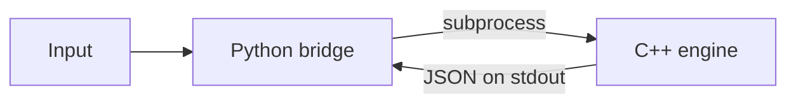
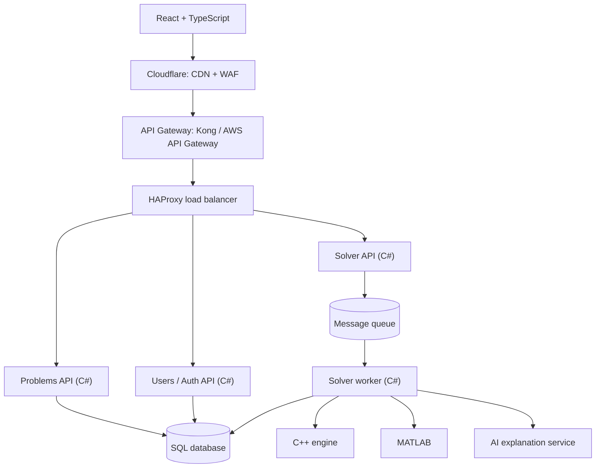
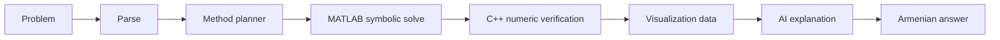

# Architecture

MATHESIS.AM  solves math analysis problems (limits, derivatives, integrals), shows the step-by-step method, visualizes the result in 2D/3D and explains it in Armenian.

**Language rule:** C++ for the math engine and anything low-level or speed-critical. C# / .NET for the APIs and everything above the engine. MATLAB for symbolic math. React + TypeScript for the UI.

## Current state (working now)



- `engine/`: tokenizer, recursive descent parser, numeric derivative
- `python/bridge/`: calls the compiled engine and returns a dict

## Target architecture



### Layers

| Layer | Role | Tech |
|---|---|---|
| User layer | Browser / mobile UI | React + TypeScript |
| CDN + WAF | Fast static delivery, blocks malicious requests | Cloudflare |
| API Gateway | Single entry point: JWT check, rate limiting, request validation, routing, logging | Kong or AWS API Gateway |
| Load balancer | Spreads traffic across replicas of each service, removes single points of failure | HAProxy |
| API services | Business logic and HTTP endpoints | C# / ASP.NET Core |
| Message queue | Holds long solve jobs so the API answers immediately | RabbitMQ or similar |
| Solver worker | Runs the solve pipeline | C# |
| Math engine | Fast numeric evaluation, verification, grid sampling | C++ |
| Symbolic math | Derivatives, limits, integrals | MATLAB (Symbolic Math Toolbox) |
| Database | Users, problems, results, history | SQL |

### API services

The gateway routes by path to a service. The load balancer then spreads requests across replicas of that service.

| Service | Endpoints | Behavior |
|---|---|---|
| Problems API | `GET /problems`, `GET /job/{id}`, `GET /results` | Responds immediately |
| Solver API | `POST /solve`, `POST /compare`, `GET /cache` | Queues long jobs, returns a `job_id` |
| Users / Auth API | `GET /users`, `POST /login`, `POST /logout` | User data, JWT auth |

## Solve pipeline



- MATLAB does the symbolic calculation.
- The C++ engine independently checks MATLAB's answer numerically. This is the "Verified" badge in the UI.
- The C++ engine also samples the function on a grid for the 2D/3D graphs.
- The explanation is generated in Armenian at the end of the pipeline.

## C# and C++ interaction

1. **First:** C# starts the engine as a subprocess and reads JSON from stdout (same idea as `python/bridge/cpp_bridge.py`). Simple, works now.
2. **Later, if speed requires it:** build the engine as a shared library and call it from C# with P/Invoke.

## Planned repo layout

```
engine/      C++ math engine
api/         C# solution (API services, worker, tests)
matlab/      MATLAB scripts
python/      tooling and prototypes
frontend/    React + TypeScript
docs/        architecture and notes
```

## Status

| Part | Status |
|---|---|
| C++ parser | Done |
| Numeric derivative | Done |
| Python bridge (prototype) | Done |
| Variables and functions (x, sin, exp) | Next |
| MATLAB integration | Planned |
| C# API services | Planned |
| Solver worker + message queue | Planned |
| AI explanation service (Armenian) | Planned |
| Frontend (React + TypeScript) | Later |
| Gateway, load balancer, CDN/WAF | Later |